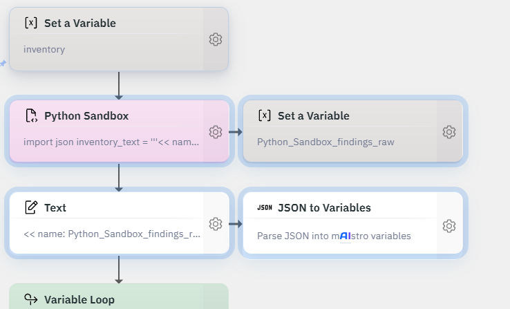
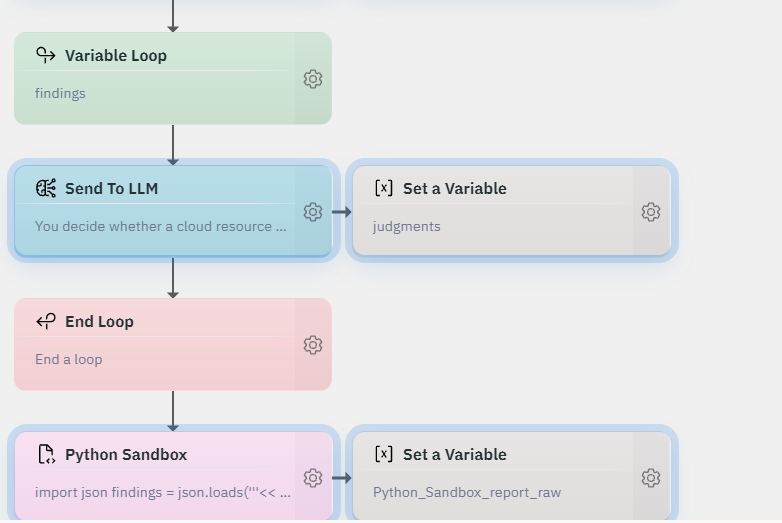
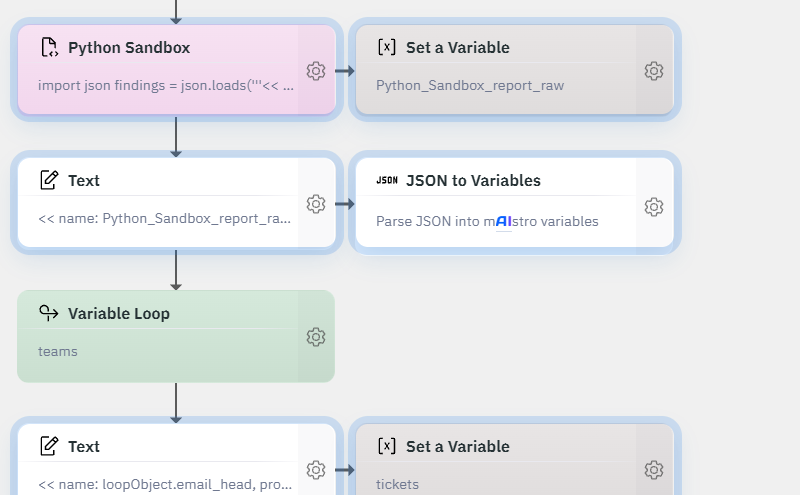
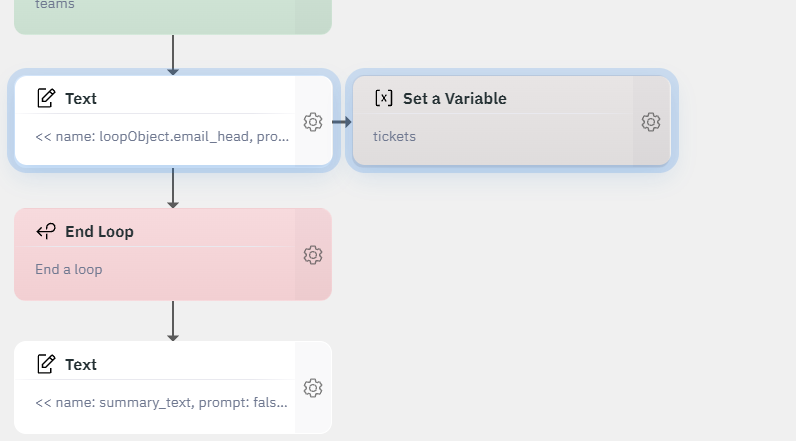

# Cloud Waste Agent (NeuralSeek mAIstro)

Author: Alfez Khan, AI Agent Developer Intern, NeuralSeek

An AI agent built in mAIstro that reads a company's cloud resource inventory, finds resources that look wasteful,
calculates the monthly saving with fixed formulas, separates real waste from resources that are idle on purpose, and
writes one review email per owner team. **It never deletes or changes anything: every action needs a person's approval.**

## Why it exists, and the design problem
Cloud bills hide waste (idle GPUs, orphaned volumes, unused load balancers). The risky failure is the opposite one:
recommending deletion of something that is idle on purpose (a standby replica, a legal-hold volume, a shared build
server). LLMs are also poor at arithmetic. So the work is split:

1. **Detect (code)** - Python Sandbox 1 applies six fixed rules and computes every saving.
2. **Judge (AI)** - an LLM reads only the free-text team notes of each finding and answers RECOMMEND or CONFIRM.
3. **Merge (code)** - Python Sandbox 2 combines rules, safety nets and the AI vote, totals the money and builds each
   team's email. If anything says CONFIRM, the saving is **not counted**.
4. **Write (code template)** - subject, greeting, facts and totals are generated from a template, so a wrong team name
   or number can never appear.

The AI never does maths and never decides alone. If the judge returns nothing, findings fall back to
"owner must confirm" (fail safe).

## Workflow (node by node)
The screenshots below are the exported agent in the mAIstro panel, in execution order. Copies are in `workflow_screenshots/`.

### 1. Input and detection

- **Set a Variable `inventory`** takes the pasted inventory JSON (prompted as `inventory_in`).
- **Python Sandbox 1** applies rules R1-R6 and the safety nets, computes savings, outputs JSON.
- **Set a Variable `Python_Sandbox_findings_raw`** stores that JSON; **Text + JSON to Variables** turns it into a
  `findings` array.

### 2. AI judge loop

- **Variable Loop `findings`** goes through the findings one at a time.
- **Send To LLM** reads the team's notes and returns one line: `reference ## RECOMMEND or CONFIRM ## reason`.
- **Set a Variable `judgments`** (append mode) collects every answer. **End Loop** closes the loop.

### 3. Merge and report

- **Python Sandbox 2** reads the judgments (tolerant of format changes), applies the abandonment gate, totals the
  savings and builds the per-team email text. Output is stored in `Python_Sandbox_report_raw`.
- **Text + JSON to Variables** exposes `summary_text` and a `teams` array. **Variable Loop `teams`** starts.

### 4. Emails and final output

- **Text** builds one email per team (heading, facts, total, signature) and **Set a Variable `tickets`** appends it.
- After **End Loop**, the final **Text** node outputs `summary_text` followed by all the emails.

## How to use the agent
1. Open **mAIstro**, open the **Agent NTL** tab, press **Ctrl+A**, paste `flow/cloud_waste_full_flow.ntl`, switch to
   the **Agent Editor** and click **Save**. (Or import the exported `.dat` file.)
2. Click **Evaluate**. When asked for `inventory_in`, paste the full text of an inventory JSON file
   (try `test_data/inventory_small.json` first).
3. Read the output: a **report summary** (findings, recommended with monthly saving, owner-must-confirm with possible
   saving that is *not counted*), then **one email per team**.
4. Send each email to its team. For recommended items the owner replies to approve; for "confirm" items the owner says
   whether the resource is still needed. The agent changes nothing itself.

**Inventory format:** `{"resources": [ ... ]}`. Each resource has `resource_id, type (vm, gpu_vm, database, volume,
snapshot, load_balancer), name, size, monthly_cost_usd, avg_util_7d, max_util_7d, environment (dev, test, staging,
prod), owner_team, attached, unattached_days, age_days, runs_24x7, tags, notes, next_size_cost_usd, requests_14d`.
See the files in `test_data/` for examples.

**Troubleshooting**
- A line starting `WARNING: the AI judge returned nothing usable...` means the LLM answer could not be read. Nothing
  unsafe happens: every finding with notes is held for confirmation. The raw judge text is printed after the warning.
- "Why we are asking: no judgment returned" on single items means the judge skipped that item; it is held for
  confirmation.
- To change thresholds (for example GPU idle below 15%), edit the rule constants in Python Sandbox 1
  (`scripts/detect_sandbox.py`).

## Rules (fixed, in detect_sandbox.py)
- R1 Idle GPU: average GPU use under 15% over 7 days. Dev/test running 24/7: schedule off (saves 108 of 168 hours, 64.3%); otherwise one size down.
- R2 Always-on dev/test VM or database with average use under 30%: schedule off.
- R3 Volume unattached for more than 14 days: snapshot, then delete.
- R4 Snapshot older than 90 days: review and delete.
- R5 Prod/staging VM or database with average use under 20% and peak under 40%: one size down.
- R6 Load balancer with fewer than 100 requests in 14 days: delete.

**Safety nets** (any one moves an item to "owner must confirm" and its saving is not counted): protected tags
(standby, dr-, failover, retention, legal, hold, compliance, scheduled), keywords in the notes (standby, replica, audit,
weekly, quarterly, on purpose and similar), unknown owner, the AI judge, and an **abandonment gate**: a RECOMMEND from
the AI only counts if the notes also contain a clear phrase such as "left over", "replaced", "cancelled", "forgot".

## Testing and results
Test data is synthetic (`test_data/`, with answer keys). Totals are computed by code and were checked independently.

| Test | Result |
|---|---|
| inventory_small (12 resources), live | 7 findings, 4 recommended $4,665.83, 3 to confirm $6,100.00 - exact match |
| inventory_holdout (40), 3 live runs, judge v1 | Totals always consistent with decisions; judge made 1-2 wrong calls per run (e.g. a shared template volume recommended) |
| inventory_fresh (39), 3 live runs, judge v2 | Judge correct on 7, 9 and 8 of 15 judge-dependent items; 3-4 wrongly recommended per run |
| inventory_final (33), live runs | Judge answered all 23 calls correctly in shape but wrote the resource name instead of the ID, so the old parser matched none and the agent failed safe (6 recommended $3,363.14, 17 to confirm $9,411.43, 0 unsafe). After the parser fix, replaying the real judge output gives **11 recommended $6,216.42, 12 to confirm $6,558.15, 0 unsafe, 1 missed saving ($64)**; perfect would be 12 / $6,280.42 |
| Offline stress test of the safety gate | A judge that always says RECOMMEND still produced **0 unsafe recommendations** on the small, 80-resource, holdout and fresh sets |
| Offline parser test | Six different judge output formats (including glued lines and no IDs) all give the exact expected result on inventory_final |

## Issues found and fixed during testing
1. **Email openings misplaced (off-by-one)** when an LLM wrote them: replaced by a code template.
2. **"no judgment returned" (random)**: mAIstro append mode glued answers on one line. The parser now finds IDs anywhere in the text.
3. **Unsafe recommendations from the 8B judge** (tax-records snapshot, failover load balancer, shared volume): blocked by the abandonment gate.
4. **Judge wrote the resource name instead of the ID** (found by reading the exported run log): the parser now accepts either the ID or the name, any separator, and the report prints a warning with the raw judge text if nothing is readable.
5. Misleading wording for resize items, double full stops, awkward "unassigned team" heading: fixed.

## Folder contents
- `flow/cloud_waste_full_flow.ntl`   The complete agent (paste into the Agent NTL tab).
- `scripts/detect_sandbox.py`, `scripts/merge_sandbox.py`   The two Python sandboxes (also embedded in the .ntl).
- `prompts/judge_prompt.txt`   The AI judge prompt.
- `workflow_screenshots/`   The four panel screenshots shown above.
- `test_data/`   Inventories (small, 80, holdout, fresh, final) and answer keys.

## Known limits
- Synthetic data and starting-point thresholds; no live cloud connection; no action is ever executed.
- The small 8B judge model is unreliable: it varies between runs and sometimes returns unreadable text. The code
  safety layers (rules, keywords, gate, fail-safe) exist because of this. A stronger model should improve it.
- The safety gate is cautious: genuine waste whose notes use unusual wording is held for confirmation, which loses
  some savings but never causes an unsafe recommendation. The keyword list also over-holds (e.g. "retain").
- On the live judge output of inventory_final the judge was right on 11 of 13 judge-dependent items; its one unsafe answer (a backup load balancer marked RECOMMEND) was blocked by the abandonment gate. Re-run live with the final flow to confirm end to end.
